# Database schema

The server stores every collection in a **typed Postgres table** (`src/db/schema/<collection>.js`
is the source of truth, `src/db/migrations/001_typed_schema.sql` the DDL that was generated from it).
Controllers, services, policies and the browser wire contract (`/dbGet /dbQuery /dbCommit /dbChanges`)
are unchanged: the store still has the Firestore Admin API (`collection().doc().get/set/update`,
`where/orderBy/limit`, `runTransaction`, `batch`, `FieldValue`), implemented in `src/db/store/`.

## How a document maps to a row

Every table has `id text PRIMARY KEY`, one column per known document field, then
`extra jsonb NOT NULL DEFAULT '{}'`, `version bigint`, `created_at`, `updated_at`.

* Document fields are camelCase; columns are snake_case (the table below lists both). The document's own
  `createdAt` / `updatedAt` are the columns `doc_created_at` / `doc_updated_at`; the row's `created_at` /
  `updated_at` are bookkeeping of the row (the Firestore copy fills them with the original create/update time).
* `version` starts at 1 and is incremented by every write. The browser's `v` token is `"v<version>"`, and
  `dbCommit` preconditions compare against it exactly as before.
* **`extra` is what makes every document round-trip exactly** (same keys, same values). It holds
  1. keys that have no column (the client spreads whole forms, legacy fields, `hobby: ...`),
  2. explicit nulls (`token: null` comes back as `null`, an absent key stays absent),
  3. values that do not fit their column: `seats: "2"`, a `status` nobody planned, `dob: "2000-02-30"`,
     `0.1 + 0.2` as a rupee amount. They are **never rejected and never coerced**; the column stays NULL and the
     value lives in `extra`. Writing a fitting value later moves it back into the column.
  On read, columns and `extra` are merged back into one document.
* That is also why **columns are nullable** (an absent key must be representable) and why CHECK constraints
  can never be violated by the store: a value outside an enum / range is diverted to `extra` before it
  reaches SQL. The CHECKs still protect everyone who writes with plain SQL.
* Queries compare typed columns natively (and use the indexes below). A value that was diverted to `extra`
  is only found by queries on a *value that cannot fit the column* (e.g. `where('status', '==', 'weird')`),
  not by range queries or `orderBy`: `orderBy(field)` drops rows whose column is NULL, as it always dropped rows
  with a missing field. (Documented deviation: a row with an explicit `null` in an ordered column is also
  dropped now; the old store kept it.)

### Type rules

| SQL type | accepts (anything else goes to `extra`) | reads back as |
| --- | --- | --- |
| `text` | string (and, where listed, one of the enum values) | string |
| `integer` / `bigint` | JSON integer (int4 range / up to 2^53), optional min / max | number |
| `numeric(12,2)` | number with at most 2 decimals, below 10^10 (rupees, not paise) | JS number |
| `boolean` | boolean | boolean |
| `timestamptz` | **only** strings of the exact form `YYYY-MM-DDTHH:mm:ss.SSSZ` | the same string (clients revive that pattern into Timestamps) |
| `date` | **only** `YYYY-MM-DD` that is a real calendar day | the same string (never revived to a Timestamp) |
| `text[]` | array of strings | array |
| `jsonb` | any JSON (nested arrays / objects) | the same JSON |

Events' `date` (a label such as `Sat, Oct 10, 6:30 PM`) and `time` are plain `text`: they are not parseable
dates. Rupee amounts are `numeric(12,2)`; `payments` also keeps `amount_paise bigint`.

### Collections outside the registry

A collection that has no file in `src/db/schema/` is stored in the generic table `docs_other`
(`path` PK = `<collection>/<id>`, `collection`, `doc_id`, `data jsonb`, `version`, `created_at`, `updated_at`,
GIN on `data`). Browser policies (`src/db/policies.js`) still deny every collection that has no rule, typed or not.

## ER diagram

Solid lines are real foreign keys; dashed lines are **soft references** (same value, no constraint; see the
rationale below). All relationships are on the *document field* named on the line.

```mermaid
erDiagram
    users ||..o{ users : "guideId (soft)"
    users ||..o{ registrations : "userId (soft)"
    events ||..o{ registrations : "eventId (soft, mock ids exist)"
    events ||--|| event_secrets : "id = event id (FK, ON DELETE CASCADE)"
    users ||..o{ attendance : "userId (soft)"
    events ||..o{ attendance : "eventId (soft)"
    users ||..o{ prasadam_logs : "userId (soft)"
    events ||..o{ prasadam_logs : "eventId (soft)"
    users ||..o{ sadhana_logs : "userId (soft)"
    sevas ||..o{ seva_registrations : "sevaId (soft)"
    users ||..o{ seva_registrations : "userId (soft)"
    trips ||..o{ trip_registrations : "tripId (soft)"
    users ||..o{ trip_registrations : "userId (soft)"
    trip_registrations ||..o{ payments : "tripRegistrationId (soft)"
    trips ||..o{ payments : "tripId (soft)"
    users ||..o{ payments : "userId (soft)"
    payments |o..o| trip_registrations : "paymentOrderId (soft)"
    users ||..o{ accommodation_requests : "userId (soft)"
    hostel_listings ||..o{ hostel_bookings : "listingId (soft)"
    users ||..o{ hostel_bookings : "userId (soft)"
    courses ||..o{ enrollments : "courseId (soft)"
    users ||..o{ enrollments : "userId (soft)"
    users ||..o{ followups : "memberId / guideId (soft)"
    users ||..o{ contact_messages : "userId (soft)"
    users ||..o{ broadcasts : "byUid (soft)"

    users {
        text id PK "Firebase uid or manual_<uuid>"
        text qr_token UK "nullable"
        text phone_normalized "indexed"
        text guide_id "soft -> users"
        text role "admin|folks_head|devotee|volunteer"
        text stage
        int streak
        int score
    }
    events {
        text id PK
        text date_label "human text"
        timestamptz date_iso
        text audience "all|mine|residents"
        text owner_id "soft -> users"
        int attending_count
        int declined_count
    }
    event_secrets {
        text id PK "FK -> events.id"
        text attendance_token
    }
    registrations {
        text id PK "eventId_userId"
        text event_id UK "with user_id"
        text user_id UK
        text token "partial index"
        text status "Attending|Not Attending|Cancelled"
    }
    attendance {
        text id PK "eventId_userId"
        text event_id UK "with user_id"
        text user_id UK
        timestamptz doc_created_at
    }
    prasadam_logs {
        text id PK "eventId_userId"
        text event_id UK "with user_id"
        text user_id UK
        timestamptz recorded_at
    }
    sadhana_logs {
        text id PK "uid_YYYY-MM-DD"
        text user_id UK "with log_date"
        date log_date UK
        int rounds_completed
        int score
    }
    sevas {
        text id PK
        date seva_date
        int max_volunteers
        int count_registered
    }
    seva_registrations {
        text id PK "userId_sevaId"
        text user_id UK "with seva_id"
        text seva_id UK
        text status
    }
    trips {
        text id PK
        text slug UK
        numeric price
        date start_date
        int capacity
        jsonb itinerary
        text_array gallery
    }
    trip_registrations {
        text id PK
        text trip_id "soft -> trips"
        text user_id "soft -> users"
        int seats "1..20"
        numeric amount_due
        text payment_order_id "soft -> payments"
        text status "pending|confirmed|waitlisted|cancelled"
        jsonb travellers
    }
    payments {
        text id PK "Razorpay order id"
        text user_id
        numeric amount
        bigint amount_paise
        text status
        text trip_registration_id "soft"
    }
    accommodation_requests {
        text id PK
        text user_id
        date arrival_date
        text status
    }
    hostel_listings {
        text id PK
        int capacity
        text_array amenities
    }
    hostel_bookings {
        text id PK
        text listing_id "soft"
        text user_id "soft"
        date check_in
        text status
    }
    courses {
        text id PK
        int sessions
    }
    enrollments {
        text id PK "courseId_userId"
        text course_id UK "with user_id"
        text user_id UK
        int sessions_attended
    }
    followups {
        text id PK
        text member_id "soft"
        text guide_id "soft"
    }
    notifications {
        text id PK
    }
    contact_messages {
        text id PK
        text user_id "soft"
    }
    broadcasts {
        text id PK
        jsonb audience
        text_array params
    }
    otp_codes {
        text id PK "91XXXXXXXXXX"
        timestamptz expires_at
        jsonb sends
    }
    system {
        text id PK "migration|seeds|phoneIndex"
    }
```

## Foreign keys versus soft references

Exactly **one** foreign key exists: `event_secrets.id -> events.id ON DELETE CASCADE DEFERRABLE INITIALLY DEFERRED`.

* The secret is created in the same batch as its event and is meaningless without it; it carries no data worth
  keeping, so cascading its deletion cannot lose anything. It is DEFERRABLE so a batch may write the secret before
  the event. (Orphan secrets exist in legacy data, because the client deletes events directly; migration 002 puts
  those into `migration_rejects`, see MIGRATIONS.md.)

Everything else is a **soft reference with an index**, on purpose, because the inventory shows integrity is *not*
guaranteed:

* `registrations.event_id`, `attendance.event_id`, `prasadam_logs.event_id`: mock events (`mock...`) have no
  `events` row, and clients create events and registrations independently.
* any `user_id` / `member_id` / `guide_id`: staff-created profiles use `manual_<uuid>` ids and users can be
  deleted by an admin while their history must stay; `spouse_id` is free text.
* `payments.*`: a ledger must outlive the registration, trip or user it refers to (`ON DELETE SET NULL` would
  destroy the link, `RESTRICT` would block admins' deletes). `payments.event_id` actually holds a *trip* id.
* `trip_registrations.trip_id`, `enrollments.course_id`, `seva_registrations.seva_id`, `hostel_bookings.listing_id`:
  admins delete trips / courses / sevas / listings and the UI does not cascade; a RESTRICT FK would make those
  deletes fail (a behaviour change) and CASCADE would silently delete bookings and payment pointers.

Natural keys that are also encoded in composite ids are `UNIQUE`: `(event_id, user_id)` on registrations,
attendance and prasadam_logs; `(user_id, log_date)` on sadhana_logs; `(user_id, seva_id)`; `(course_id, user_id)`;
`trips.slug`; `users.qr_token` (NULLs allowed). They are an extra safety net next to the deterministic ids. A "one live
trip registration per user and trip" rule is *not* enforced: the inventory shows it is a UI rule only.

## Tables
### `users`

Member and staff profiles; also the sadhana aggregate (streak, score) and follow-up bookkeeping.  
**Id:** Firebase Auth uid, or manual_<uuid> for staff-created profiles without a login

| document field | column | type | constraint |
| --- | --- | --- | --- |
| `uid` | `uid` | text |  |
| `name` | `name` | text |  |
| `fullName` | `full_name` | text |  |
| `displayName` | `display_name` | text |  |
| `email` | `email` | text |  |
| `phone` | `phone` | text |  |
| `phoneNormalized` | `phone_normalized` | text |  |
| `photo` | `photo` | text |  |
| `photoURL` | `photo_url` | text |  |
| `profileImage` | `profile_image` | text |  |
| `role` | `role` | text | one of `admin`, `folks_head`, `devotee`, `volunteer` |
| `qrToken` | `qr_token` | text |  |
| `username` | `username` | text |  |
| `createdAt` | `doc_created_at` | timestamptz |  |
| `updatedAt` | `doc_updated_at` | timestamptz |  |
| `gender` | `gender` | text |  |
| `dob` | `dob` | date |  |
| `occupation` | `occupation` | text |  |
| `qualification` | `qualification` | text |  |
| `city` | `city` | text |  |
| `state` | `state` | text |  |
| `country` | `country` | text |  |
| `center` | `center` | text |  |
| `address` | `address` | text |  |
| `fatherName` | `father_name` | text |  |
| `fatherPhone` | `father_phone` | text |  |
| `spouseId` | `spouse_id` | text |  |
| `level` | `level` | text |  |
| `stage` | `stage` | text | one of `new`, `regular`, `practising`, `committed`, `resident` |
| `guideId` | `guide_id` | text |  |
| `guideName` | `guide_name` | text |  |
| `guidePhone` | `guide_phone` | text |  |
| `assignedGroup` | `assigned_group` | text |  |
| `nextFollowUpDate` | `next_follow_up_date` | date |  |
| `lastFollowUpAt` | `last_follow_up_at` | timestamptz |  |
| `lastFollowUpNote` | `last_follow_up_note` | text |  |
| `streak` | `streak` | integer | >= 0 |
| `longestStreak` | `longest_streak` | integer | >= 0 |
| `score` | `score` | integer | >= 0 |
| `lastSadhanaDate` | `last_sadhana_date` | date |  |
| `lastCompletedSadhanaDate` | `last_completed_sadhana_date` | date |  |
| `sadhanaTarget` | `sadhana_target` | integer | >= 0 |
| `metadata` | `metadata` | jsonb |  |

**Unique:** `qr_token`  
**Indexes:** `(phone_normalized)`; `(phone)`; `(guide_id)`; `(role)`; `(uid)`

### `events`

Programs / calendar entries, public site listing and RSVP counters. `date` is a human label, `dateISO` the machine date.  
**Id:** 20-char auto id

| document field | column | type | constraint |
| --- | --- | --- | --- |
| `title` | `title` | text |  |
| `category` | `category` | text |  |
| `date` | `date_label` | text |  |
| `dateISO` | `date_iso` | timestamptz |  |
| `time` | `time_label` | text |  |
| `location` | `location` | text |  |
| `description` | `description` | text |  |
| `img` | `img` | text |  |
| `audience` | `audience` | text | one of `all`, `mine`, `residents` |
| `ownerId` | `owner_id` | text |  |
| `ownerName` | `owner_name` | text |  |
| `groupId` | `group_id` | text |  |
| `createdBy` | `created_by` | text |  |
| `createdAt` | `doc_created_at` | timestamptz |  |
| `updatedAt` | `doc_updated_at` | timestamptz |  |
| `attendingCount` | `attending_count` | integer | >= 0 |
| `declinedCount` | `declined_count` | integer | >= 0 |
| `attendees` | `attendees` | integer | >= 0 |
| `status` | `status` | text |  |

**Indexes:** `(date_iso)`; `(owner_id)`; `(audience)`

### `event_secrets`

Server-only: the self check-in token of an event (id = event id). The only table with a hard FK.  
**Id:** the event id

| document field | column | type | constraint |
| --- | --- | --- | --- |
| `attendanceToken` | `attendance_token` | text |  |
| `createdAt` | `doc_created_at` | timestamptz |  |

**Foreign key:** `id` -> `events (id)` ON DELETE CASCADE (deferrable, initially deferred)

### `registrations`

A member's RSVP to an event (also holds the per-RSVP gate token).  
**Id:** <eventId>_<userId>

| document field | column | type | constraint |
| --- | --- | --- | --- |
| `eventId` | `event_id` | text |  |
| `eventTitle` | `event_title` | text |  |
| `userId` | `user_id` | text |  |
| `userName` | `user_name` | text |  |
| `token` | `token` | text |  |
| `status` | `status` | text | one of `Attending`, `Not Attending`, `Cancelled` |
| `updatedAt` | `doc_updated_at` | timestamptz |  |
| `createdAt` | `doc_created_at` | timestamptz |  |

**Unique:** `event_id, user_id`  
**Indexes:** `(user_id)`; `(token)` where `token IS NOT NULL`

### `attendance`

One check-in per user per event. "Absent" is the absence of a row (roll-call un-tick deletes it).  
**Id:** <eventId>_<userId>

| document field | column | type | constraint |
| --- | --- | --- | --- |
| `userId` | `user_id` | text |  |
| `uid` | `uid` | text |  |
| `name` | `name` | text |  |
| `eventId` | `event_id` | text |  |
| `session` | `session` | text |  |
| `status` | `status` | text |  |
| `method` | `method` | text |  |
| `markedBy` | `marked_by` | text |  |
| `markedByName` | `marked_by_name` | text |  |
| `time` | `time_label` | text |  |
| `createdAt` | `doc_created_at` | timestamptz |  |
| `timestamp` | `recorded_at` | timestamptz |  |

**Unique:** `event_id, user_id`  
**Indexes:** `(user_id)`; `(doc_created_at DESC)`

### `prasadam_logs`

Prasadam received at an event (scanner only).  
**Id:** <eventId>_<userId>

| document field | column | type | constraint |
| --- | --- | --- | --- |
| `userId` | `user_id` | text |  |
| `name` | `name` | text |  |
| `eventId` | `event_id` | text |  |
| `eventTitle` | `event_title` | text |  |
| `received` | `received` | boolean |  |
| `timestamp` | `recorded_at` | timestamptz |  |

**Unique:** `event_id, user_id`  
**Indexes:** `(user_id)`; `(recorded_at DESC)`

### `sadhana_logs`

Daily chanting log, one per user per IST calendar day.  
**Id:** <uid>_<YYYY-MM-DD> (IST date)

| document field | column | type | constraint |
| --- | --- | --- | --- |
| `userId` | `user_id` | text |  |
| `date` | `log_date` | date |  |
| `userName` | `user_name` | text |  |
| `target` | `target` | integer | >= 0 |
| `roundsCompleted` | `rounds_completed` | integer | >= 0 |
| `progressPercentage` | `progress_percentage` | integer | >= 0; <= 100 |
| `streak` | `streak` | integer | >= 0 |
| `score` | `score` | integer |  |
| `status` | `status` | text |  |
| `completed` | `completed` | boolean |  |
| `bonusClaimed` | `bonus_claimed` | jsonb |  |
| `createdAt` | `doc_created_at` | timestamptz |  |
| `updatedAt` | `doc_updated_at` | timestamptz |  |

**Unique:** `user_id, log_date`  
**Indexes:** `(user_id, log_date DESC)`

### `sevas`

Volunteer service slots; `countRegistered` is the seat counter the client maintains.  
**Id:** 20-char auto id

| document field | column | type | constraint |
| --- | --- | --- | --- |
| `title` | `title` | text |  |
| `description` | `description` | text |  |
| `sevaType` | `seva_type` | text |  |
| `date` | `seva_date` | date |  |
| `time` | `time_label` | text |  |
| `location` | `location` | text |  |
| `maxVolunteers` | `max_volunteers` | integer | >= 0 |
| `isRecurring` | `is_recurring` | boolean |  |
| `countRegistered` | `count_registered` | integer | >= 0 |
| `createdBy` | `created_by` | text |  |
| `createdAt` | `doc_created_at` | timestamptz |  |
| `updatedAt` | `doc_updated_at` | timestamptz |  |

**Indexes:** `(seva_date)`

### `seva_registrations`

A member's seat in a seva (policy forces id = `<userId>_<sevaId>`).  
**Id:** <userId>_<sevaId>

| document field | column | type | constraint |
| --- | --- | --- | --- |
| `userId` | `user_id` | text |  |
| `sevaId` | `seva_id` | text |  |
| `sevaTitle` | `seva_title` | text |  |
| `userName` | `user_name` | text |  |
| `userPhone` | `user_phone` | text |  |
| `status` | `status` | text | one of `registered`, `cancelled`, `completed` |
| `createdAt` | `doc_created_at` | timestamptz |  |
| `updatedAt` | `doc_updated_at` | timestamptz |  |

**Unique:** `user_id, seva_id`  
**Indexes:** `(seva_id)`

### `trips`

Yatras: public listing and booking. Business key: `slug`.  
**Id:** 20-char auto id

| document field | column | type | constraint |
| --- | --- | --- | --- |
| `slug` | `slug` | text |  |
| `title` | `title` | text |  |
| `subtitle` | `subtitle` | text |  |
| `location` | `location` | text |  |
| `description` | `description` | text |  |
| `coverImage` | `cover_image` | text |  |
| `gallery` | `gallery` | text[] |  |
| `startDate` | `start_date` | date |  |
| `endDate` | `end_date` | date |  |
| `durationLabel` | `duration_label` | text |  |
| `price` | `price` | numeric(12,2) | >= 0 |
| `originalPrice` | `original_price` | numeric(12,2) | >= 0 |
| `advanceAmount` | `advance_amount` | numeric(12,2) | >= 0 |
| `capacity` | `capacity` | integer | >= 0 |
| `eligibility` | `eligibility` | text |  |
| `status` | `status` | text | one of `draft`, `upcoming`, `ongoing`, `completed`, `cancelled` |
| `registrationOpen` | `registration_open` | boolean |  |
| `onlinePaymentEnabled` | `online_payment_enabled` | boolean |  |
| `cashPaymentEnabled` | `cash_payment_enabled` | boolean |  |
| `highlights` | `highlights` | text[] |  |
| `inclusions` | `inclusions` | text[] |  |
| `exclusions` | `exclusions` | text[] |  |
| `itinerary` | `itinerary` | jsonb |  |
| `locations` | `locations` | jsonb |  |
| `meetingPoint` | `meeting_point` | text |  |
| `contactPhone` | `contact_phone` | text |  |
| `createdBy` | `created_by` | text |  |
| `createdAt` | `doc_created_at` | timestamptz |  |
| `updatedAt` | `doc_updated_at` | timestamptz |  |

**Unique:** `slug`  
**Indexes:** `(start_date)`

### `trip_registrations`

A seat booking; also holds the payment pointer and the cash attestation.  
**Id:** 20-char auto id

| document field | column | type | constraint |
| --- | --- | --- | --- |
| `tripId` | `trip_id` | text |  |
| `tripSlug` | `trip_slug` | text |  |
| `tripTitle` | `trip_title` | text |  |
| `userId` | `user_id` | text |  |
| `userName` | `user_name` | text |  |
| `userPhone` | `user_phone` | text |  |
| `userEmail` | `user_email` | text |  |
| `seats` | `seats` | integer | >= 1; <= 20 |
| `amountDue` | `amount_due` | numeric(12,2) | >= 0 |
| `paymentMode` | `payment_mode` | text | one of `online`, `cash` |
| `paymentOrderId` | `payment_order_id` | text |  |
| `status` | `status` | text | one of `pending`, `confirmed`, `waitlisted`, `cancelled` |
| `confirmedBy` | `confirmed_by` | text |  |
| `staffNotes` | `staff_notes` | text |  |
| `cashCollected` | `cash_collected` | boolean |  |
| `cashAmount` | `cash_amount` | numeric(12,2) | >= 0 |
| `cashCollectedAt` | `cash_collected_at` | timestamptz |  |
| `cashCollectedBy` | `cash_collected_by` | text |  |
| `travellers` | `travellers` | jsonb |  |
| `emergencyContact` | `emergency_contact` | text |  |
| `pickup` | `pickup` | text |  |
| `travellerNotes` | `traveller_notes` | text |  |
| `createdAt` | `doc_created_at` | timestamptz |  |
| `updatedAt` | `doc_updated_at` | timestamptz |  |

**Indexes:** `(user_id)`; `(trip_id, status)`; `(payment_order_id)` where `payment_order_id IS NOT NULL`

### `payments`

Razorpay order ledger (server-written). Rupees and paise both kept.  
**Id:** Razorpay order id (order_XXXX)

| document field | column | type | constraint |
| --- | --- | --- | --- |
| `userId` | `user_id` | text |  |
| `amount` | `amount` | numeric(12,2) | >= 0 |
| `amountPaise` | `amount_paise` | bigint | >= 0 |
| `currency` | `currency` | text |  |
| `purpose` | `purpose` | text | one of `trip`, `donation` |
| `tripId` | `trip_id` | text |  |
| `tripRegistrationId` | `trip_registration_id` | text |  |
| `eventId` | `event_id` | text |  |
| `status` | `status` | text | one of `pending`, `completed`, `failed`, `amount_mismatch` |
| `verified` | `verified` | boolean |  |
| `paymentId` | `payment_id` | text |  |
| `method` | `method` | text |  |
| `verifiedBy` | `verified_by` | text |  |
| `capturedAt` | `captured_at` | timestamptz |  |
| `failedAt` | `failed_at` | timestamptz |  |
| `failureReason` | `failure_reason` | text |  |
| `lastFailedAttempt` | `last_failed_attempt` | jsonb |  |
| `paidAmountPaise` | `paid_amount_paise` | bigint | >= 0 |
| `paidCurrency` | `paid_currency` | text |  |
| `createdAt` | `doc_created_at` | timestamptz |  |
| `updatedAt` | `doc_updated_at` | timestamptz |  |

**Indexes:** `(user_id)`; `(trip_registration_id)` where `trip_registration_id IS NOT NULL`; `(status)`

### `accommodation_requests`

Stay requests; status changes go through the server.  
**Id:** 20-char auto id

| document field | column | type | constraint |
| --- | --- | --- | --- |
| `type` | `type` | text |  |
| `guestCount` | `guest_count` | integer | >= 1 |
| `arrivalDate` | `arrival_date` | date |  |
| `departureDate` | `departure_date` | date |  |
| `requirements` | `requirements` | text |  |
| `userId` | `user_id` | text |  |
| `userName` | `user_name` | text |  |
| `status` | `status` | text | one of `pending`, `recommended`, `approved`, `rejected` |
| `createdAt` | `doc_created_at` | timestamptz |  |
| `updatedAt` | `doc_updated_at` | timestamptz |  |

**Indexes:** `(user_id, doc_created_at DESC)`; `(doc_created_at DESC)`; `(status)`; `(user_id, status)`

### `hostel_listings`

Hostel / dorm listings (public read). `active` absent means active.  
**Id:** 20-char auto id

| document field | column | type | constraint |
| --- | --- | --- | --- |
| `name` | `name` | text |  |
| `description` | `description` | text |  |
| `capacity` | `capacity` | integer | >= 0 |
| `amenities` | `amenities` | text[] |  |
| `img` | `img` | text |  |
| `active` | `active` | boolean |  |
| `createdBy` | `created_by` | text |  |
| `createdAt` | `doc_created_at` | timestamptz |  |
| `updatedAt` | `doc_updated_at` | timestamptz |  |

### `hostel_bookings`

Bookings of a hostel listing.  
**Id:** 20-char auto id

| document field | column | type | constraint |
| --- | --- | --- | --- |
| `listingId` | `listing_id` | text |  |
| `listingName` | `listing_name` | text |  |
| `userId` | `user_id` | text |  |
| `userName` | `user_name` | text |  |
| `checkIn` | `check_in` | date |  |
| `checkOut` | `check_out` | date |  |
| `guestCount` | `guest_count` | integer | >= 1 |
| `notes` | `notes` | text |  |
| `status` | `status` | text | one of `pending`, `approved`, `rejected`, `cancelled` |
| `staffNotes` | `staff_notes` | text |  |
| `createdAt` | `doc_created_at` | timestamptz |  |
| `updatedAt` | `doc_updated_at` | timestamptz |  |

**Indexes:** `(user_id, doc_created_at DESC)`; `(doc_created_at DESC)`; `(listing_id)`; `(status)`

### `courses`

Courses (sessions count drives enrollment completion).  
**Id:** 20-char auto id

| document field | column | type | constraint |
| --- | --- | --- | --- |
| `title` | `title` | text |  |
| `description` | `description` | text |  |
| `sessions` | `sessions` | integer | >= 0; <= 1000 |
| `schedule` | `schedule` | text |  |
| `active` | `active` | boolean |  |
| `createdBy` | `created_by` | text |  |
| `createdAt` | `doc_created_at` | timestamptz |  |
| `updatedAt` | `doc_updated_at` | timestamptz |  |

### `enrollments`

A member enrolled in a course (id = `<courseId>_<userId>`).  
**Id:** <courseId>_<userId>

| document field | column | type | constraint |
| --- | --- | --- | --- |
| `courseId` | `course_id` | text |  |
| `courseTitle` | `course_title` | text |  |
| `userId` | `user_id` | text |  |
| `userName` | `user_name` | text |  |
| `userPhone` | `user_phone` | text |  |
| `status` | `status` | text | one of `enrolled`, `completed` |
| `sessionsAttended` | `sessions_attended` | integer | >= 0 |
| `createdAt` | `doc_created_at` | timestamptz |  |
| `updatedAt` | `doc_updated_at` | timestamptz |  |

**Unique:** `course_id, user_id`  
**Indexes:** `(user_id)`

### `followups`

A guide's care-log entry about a member.  
**Id:** 20-char auto id

| document field | column | type | constraint |
| --- | --- | --- | --- |
| `memberId` | `member_id` | text |  |
| `memberName` | `member_name` | text |  |
| `guideId` | `guide_id` | text |  |
| `guideName` | `guide_name` | text |  |
| `channel` | `channel` | text |  |
| `note` | `note` | text |  |
| `nextDate` | `next_date` | date |  |
| `createdAt` | `doc_created_at` | timestamptz |  |
| `updatedAt` | `doc_updated_at` | timestamptz |  |

**Indexes:** `(member_id)`; `(guide_id)`; `(doc_created_at)`

### `notifications`

In-app announcements (no per-user read state).  
**Id:** 20-char auto id

| document field | column | type | constraint |
| --- | --- | --- | --- |
| `type` | `type` | text |  |
| `title` | `title` | text |  |
| `message` | `message` | text |  |
| `link` | `link` | text |  |
| `createdAt` | `doc_created_at` | timestamptz |  |
| `createdBy` | `created_by` | text |  |

**Indexes:** `(doc_created_at DESC)`

### `contact_messages`

Messages members send to the team.  
**Id:** 20-char auto id

| document field | column | type | constraint |
| --- | --- | --- | --- |
| `userId` | `user_id` | text |  |
| `name` | `name` | text |  |
| `phone` | `phone` | text |  |
| `email` | `email` | text |  |
| `topic` | `topic` | text |  |
| `message` | `message` | text |  |
| `status` | `status` | text |  |
| `createdAt` | `doc_created_at` | timestamptz |  |
| `updatedAt` | `doc_updated_at` | timestamptz |  |

**Indexes:** `(doc_created_at)`

### `broadcasts`

WhatsApp broadcast audit log (server-written).  
**Id:** 20-char auto id

| document field | column | type | constraint |
| --- | --- | --- | --- |
| `byUid` | `by_uid` | text |  |
| `byName` | `by_name` | text |  |
| `audience` | `audience` | jsonb |  |
| `templateId` | `template_id` | text |  |
| `params` | `params` | text[] |  |
| `total` | `total` | integer | >= 0 |
| `sent` | `sent` | integer | >= 0 |
| `failed` | `failed` | integer | >= 0 |
| `createdAt` | `doc_created_at` | timestamptz |  |

**Indexes:** `(doc_created_at)`

### `otp_codes`

Server-only login codes; `sends` holds epoch-ms numbers (rolling rate-limit window).  
**Id:** normalised phone, 91XXXXXXXXXX

| document field | column | type | constraint |
| --- | --- | --- | --- |
| `codeHash` | `code_hash` | text |  |
| `code` | `code` | text |  |
| `phone` | `phone` | text |  |
| `createdAt` | `doc_created_at` | timestamptz |  |
| `expiresAt` | `expires_at` | timestamptz |  |
| `attempts` | `attempts` | integer | >= 0 |
| `sends` | `sends` | jsonb |  |

**Indexes:** `(expires_at)` where `expires_at IS NOT NULL`

### `system`

Server bookkeeping documents: `migration`, `seeds`, `phoneIndex`.  
**Id:** migration | seeds | phoneIndex

| document field | column | type | constraint |
| --- | --- | --- | --- |
| `source` | `source` | text |  |
| `projectId` | `project_id` | text |  |
| `counts` | `counts` | jsonb |  |
| `firestoreLocked` | `firestore_locked` | boolean |  |
| `durationMs` | `duration_ms` | bigint |  |
| `completedAt` | `completed_at` | timestamptz |  |
| `done` | `done` | text[] |  |
| `updatedAt` | `doc_updated_at` | timestamptz |  |
| `version` | `doc_version` | integer |  |
| `scanned` | `scanned` | integer |  |
| `updated` | `updated` | integer |  |
| `builtAt` | `built_at` | timestamptz |  |

### `docs_other`, `migration_rejects`, `schema_migrations`

* `docs_other`: generic fallback described above.
* `migration_rejects (id, migration, collection, doc_id, data, error, created_at)`: documents a data migration
  or the Firestore copy could not place, with their original JSON and the reason.
* `schema_migrations (version, name, checksum, applied_at, duration_ms, details)`: applied migrations.
* `legacy_<collection>`: the old generic tables, kept (never dropped) after migration 001/002 for rollback.
